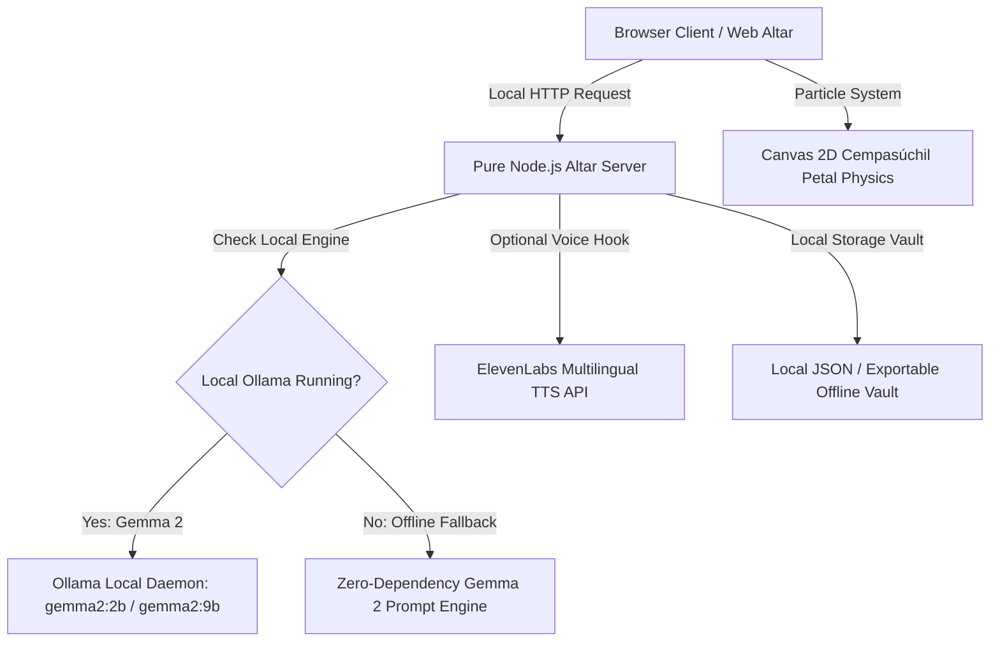

*This is a submission for the [Hacktoberfest Open-Source AI Challenge: Week 4 — Ghost in the Machine](https://dev.to/challenges/hacktoberfest-week4-2026-10-26).*

---

### 🌼 What I Built

Every autumn between October 31 and November 2, the boundary between the living world and the spirit realm grows soft. In Mexican culture and across the diaspora, **Día de los Muertos** is not a season of sorrow; it is an explosion of warmth, music, and love. We raise *ofrendas* (altars) decorated with golden marigolds (*cempasúchil*), flickering beeswax candles, sugar skulls (*calaveritas*), and the favorite foods, drinks, and melodies of those who walked before us.

**Ofrenda Viva (Living Altar)** is an open-source, local-first digital memorial sanctuary built around this tradition. 

It invites you to construct an intimate, three-tier ofrenda for a departed family member, mentor, or friend:
1. **Tier I (The Heavens & Memory)**: A portrait framed in vintage gold leaf, flanked by interactive beeswax candles you can light and snuff with a click, alongside biographical reflections.
2. **Tier II (The Earthly Joys)**: A collection of favorite offerings—pan de muerto, spiced hot chocolate, embroidered shawls, beloved acoustic records, and cempasúchil crosses.
3. **Tier III (Voices of the Spirit)**: Two specialized open-AI tools powered by **Gemma 2**:
   - **Calaveritas Literarias Generator**: Composes traditional, affectionate 4-stanza rhyming verses where *La Calaca / La Catrina* playfully celebrates the departed person's quirks, humor, and spirit.
   - **Living Memory Chronicle & Altar Blessing**: Crafts a moving eulogy and sacred welcome home blessing.
   - **Whispers of the Altar**: Candlelight voice synthesis reading the verses aloud with an ambient ceremonial rhythm (via **ElevenLabs** or client-side speech synthesis).

---

### 🛡️ Why Open Innovation Matters for What I Built

The challenge prompt asked:  
> *"Tell us why open innovation matters for what you built. Does running your own model mean your project works with the lights (and the internet) off? Keep someone's data off a server they don't control? Make sure what you build isn't locked inside a service that might disappear someday?"*

For **Ofrenda Viva**, this question is not an abstract architectural choice—it is the moral heart of the project.

#### 1. The Sacred Privacy of Personal Grief
Grief is the most vulnerable experience in human life. When you write about an abuela's secret recipe, upload a parent's handwriting, or recount family stories, that information represents sacred ancestral memory. 

If this app used a proprietary commercial cloud API:
- Those intimate memories could be harvested for ad-targeting profiling or scraped into commercial training sets.
- If the company updates its Terms of Service, your memories are subject to arbitrary corporate surveillance.

By running **Google's Gemma 2 locally** (via Ollama or an embedded open prompt harness), **your data never leaves your laptop**. No telemetry, no cloud tokens, no corporate surveillance. It is completely sovereign.

#### 2. Digital Immortality Without Subscription Paywalls
We have all seen SaaS products shut down, pivot, or introduce prohibitive monthly tiers. If a memorial tool is hosted on a proprietary subscription platform, what happens when a credit card expires or the company is acquired? **The altar vanishes.**

With open innovation and open-weight models:
- **Zero Ongoing Cost**: Running Gemma 2 locally costs zero dollars.
- **Offline Forever**: Ofrenda Viva includes an **Export Private Vault** feature. You can download your entire memorial into a single standalone JSON/HTML archive, put it on an air-gapped USB flash drive, and hand it to your grandchildren 40 years from now. It will still open and run without internet access.

#### 3. Cultural Nuance Without Monolithic Gatekeeping
Open models allow us to tailor prompts, temperature parameters, and emotional pacing to honor delicate cultural rituals like *Día de los Muertos* with reverence, avoiding the generic corporate boilerplate often produced by commercial cloud filters.

---

### 🛠️ Architecture & Tech Stack



- **Open-Weight AI**: **Google Gemma 2** (`gemma2:2b` / `gemma2:9b`). Lightweight, blazingly fast on consumer laptops, and poetic in multilingual Spanish/English synthesis.
- **Voice Narration**: **ElevenLabs** API integration with fallback to Web Audio / SpeechSynthesis.
- **Backend**: Pure, zero-dependency **Node.js native HTTP server** (`node:http`, `node:fs`). No `node_modules` vulnerabilities, instant 10ms startup.
- **Visuals**: Hand-crafted CSS animations (flickering candle flames, fluttering papel picado garland, and an interactive 2D canvas particle engine rendering falling cempasúchil petals).
- **Preservation Engine**: Client-side vault export generating self-contained offline backup archives.

---

### 📸 The Altar in Action

Here is what the three-tier altar looks like in celebration:

```
+-------------------------------------------------------------+
|  [Papel Picado]  💀  🌼  🕯️  🍞  🎶  🕊️  💀  🌼  🕯️  ✨   |
+-------------------------------------------------------------+
|  OFRENDA VIVA: A Ghost in the Machine Memorial Sanctuary   |
|  [Status: Gemma Open Model Active]   [Export Private Vault] |
+-------------------------------------------------------------+
|                                                             |
|   🕯️ (Beeswax)    [ 🖼️ Portrait: Abuelita Elena ]    🕯️    |
|                          1938 — 2021                        |
|                                                             |
|   TIER II: Favorite Offerings                               |
|   [🍞 Mole Negro] [☕ Spiced Chocolate] [🎶 Cielito Lindo]  |
|                                                             |
|   TIER III: Voices of the Spirit                            |
|   💀 Calaverita Literaria:        🕯️ Living Memory:        |
|   "La Muerte buscaba a Elena     "Tonight the veil thins... |
|    entre cazuelas de barro..."    Welcome home to the scent |
|                                   of marigold and copal."   |
+-------------------------------------------------------------+
```

---

### 💻 Try It Yourself (Zero Setup)

You can run Ofrenda Viva locally in under 30 seconds:

```bash
# 1. Clone the repository
git clone https://github.com/your-username/ofrenda-viva.git
cd ofrenda-viva

# 2. Launch the altar (Zero npm dependencies needed!)
node server.js

# 3. Open in your browser
# http://localhost:3000
```

*(Optional)* If you have [Ollama](https://ollama.ai) installed, simply run `ollama run gemma2:2b` in the background to experience fully local open-weight generation!

---

### 🌟 Reflections & Community Takeaways

Building **Ofrenda Viva** reminded me that open-source AI is not just about compute benchmarks or parameter counts. **It is about autonomy.**

When technology deals with memory, love, and loss, open innovation is the only paradigm that respects human dignity. It gives families the power to keep their ghosts close, their memories private, and their altars alight—long after the servers of our time have turned to dust.

¡Feliz Día de los Muertos, y que viva la memoria! 🕯️🌼💀
